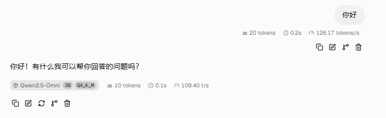

# 本地跑多模态模型记录：llama.cpp 和 vLLM

> 2026 年 11 月 26 日 · 本地模型实践记录

今天的任务是学习llama.cpp和vllm这两个推理框架，本地部署模型，下面是我的工作和踩过的坑。

## 下载 Qwen2.5-Omni

我从 Hugging Face 下载了 `ggml-org/Qwen2.5-Omni-3B-GGUF`。这次想尝试的输入包括文字、图片和音频，输出是文字；这个小模型的上下文长度才4.1k 。

模型文件下载完成后，我选择用 **llama.cpp** 加载。它既可以在 CLI 命令行里直接对话，也可以启动 HTTP 服务，让其他程序通过接口访问。对我来说，前者适合快速验证模型是否能跑，后者更适合后续接入自己的应用。

## 一个坑：模型跑起来了，却没有用上 GPU

第一次运行时，我发现推理用的是 CPU。排查后才意识到，下载的 llama.cpp 包不是 CUDA 版本，而是**Vulkan **后端。模型能正常加载，并不代表它已经在 GPU 上运行。

后来我重新下载了支持 CUDA 的包，再用 GPU 加载模型。这次经历提醒我：以后验证本地推理环境，除了看模型能否回答，还要检查使用的构建版本和实际运行设备。

## vLLM：转到 WSL2，安装还没完成

我也想试试 vLLM。由于它不原生支持 Windows，我转到 **WSL2 的 Ubuntu 24.04** 环境里尝试下载和安装。目前这一步还没有成功，暂时不记录一套未经验证的安装命令。

## 多模态的另一个模型

我还下载了 `calcuis/lumina2-Q4_k_m` 这个文生图模型。本来看着是gguf格式的权重文件，就下载到本地，准备用llama.cpp跑一遍，发现这个渲染要用ComfyUI，不需要llama.cpp。故删除....

## 今天的进度

- 下载了 Qwen2.5-Omni 的 GGUF 模型，并通过 llama.cpp 加载，测试成功。
- 发现最初使用的是 CPU 版本，随后换成 CUDA 包，用 GPU 加载。
- 在 WSL2 Ubuntu 24.04 中尝试安装 vLLM，尚未完成。
- 记下 Lumina2 文生图模型需要使用 ComfyUI，留待后续尝试。

记录，第一篇文章.....
